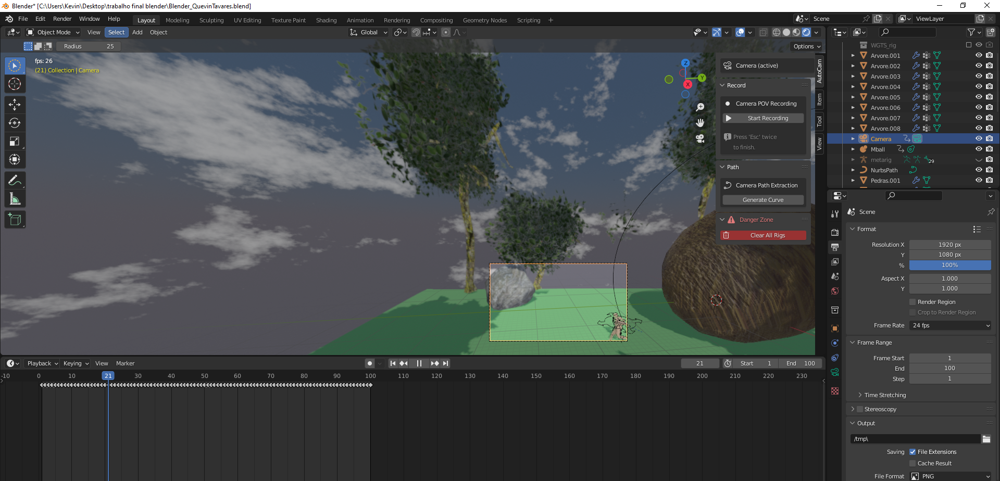

# Blender 3D Animation Project

A complete 3D animation project created in Blender, covering environment modelling, materials, character rigging, animation, camera work, atmospheric effects and sound design.



## Project overview

The project follows a character moving through a stylised natural environment. The scene combines custom and adapted 3D elements, trees, rocks, grass, sky effects, animation, camera movement and sound.

The repository documents both the final result and the production process:

- environment and object modelling;
- materials, textures and UV work;
- character rigging and weight adjustments;
- running and object animations;
- camera composition;
- wind, turbulence and sky effects;
- sound placement and final presentation.

## Final result

- [Watch on YouTube](https://www.youtube.com/watch?v=93E9mItYj8k)
- [`renders/final-animation.mp4`](renders/final-animation.mp4) — combined final version
- [`renders/first-sequence.mp4`](renders/first-sequence.mp4) — first sequence
- [`renders/second-sequence.mp4`](renders/second-sequence.mp4) — second sequence

## Repository structure

```text
blender-3d-animation/
├── src/
│   └── blender-animation.blend
├── renders/
│   ├── final-animation.mp4
│   ├── first-sequence.mp4
│   └── second-sequence.mp4
├── docs/
│   ├── presentation.pdf
│   ├── presentation.pptx
│   ├── ASSET_NOTES.md
│   └── process/
│       └── selected development screenshots
├── .gitignore
└── README.md
```

## Opening the project

1. Clone the repository.
2. Open [`src/blender-animation.blend`](src/blender-animation.blend) in Blender.
3. Review the timeline, camera, rig, materials and scene collections.
4. Use the final renders as a reference for the intended result.

The project was developed with Blender 3.3.x. Newer Blender versions may update some data when the file is saved.

## Notes about external assets

Some textures and audio used during production came from external sources. They are not redistributed in this repository because their reuse terms have not been independently verified. See [`docs/ASSET_NOTES.md`](docs/ASSET_NOTES.md) for details.

## Author

**Quévin Leonardo Aguiar Tavares**

This repository is shared as a portfolio project. No licence for reuse or redistribution has been granted.
